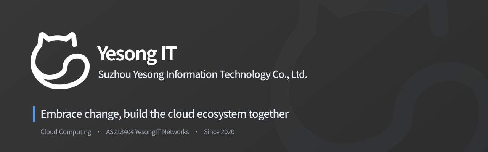

 

## About Us

**Suzhou Yesong Information Technology Co., Ltd.** (Yesong IT) was founded in 2022 and is headquartered in Xiangcheng District, Suzhou, Jiangsu, China. We build cloud and network infrastructure: cloud servers, bare metal and colocation, and networking solutions for businesses and individuals. Our work rests on two principles, **independent innovation and openness**, and our aim is to help build a thriving cloud ecosystem.

Our flagship brand **MiaoVPS** has been running since 2020 and has served **10K+** users. We also operate our own autonomous system, **AS213404 · YesongIT Networks**.

## Our Brands

<table>
  <tr>
    <td align="center" width="25%"><b>MiaoVPS</b></td>
    <td>
      <b><a href="https://www.miaovps.com/">MiaoVPS</a></b> 
      Our cloud brand in mainland China: lightweight and standard cloud servers, Hong Kong cloud servers, bare metal and colocation, plus solutions for gaming, websites and the public sector.
    </td>
  </tr>
  <tr>
    <td align="center"><b>VPS.Town</b></td>
    <td>
      <b><a href="https://vps.town/">VPS.Town Cloud</a></b> 
      Our international cloud brand, run by the MiaoVPS team and built on years of cloud operations experience.
    </td>
  </tr>
  <tr>
    <td align="center"><b>WetemCloud</b></td>
    <td>
      <b><a href="https://www.wetem.cn/">WetemCloud</a></b> 
      A cloud platform for games and developers that covers the full lifecycle, from development and release to operations.
    </td>
  </tr>
  <tr>
    <td align="center"><b>AS213404</b></td>
    <td>
      <b><a href="https://www.peeringdb.com/net/38580">YesongIT Networks</a></b> 
      Our own autonomous system, which provides fast, stable and well-connected network infrastructure for all our cloud products.
    </td>
  </tr>
</table>

## Why Yesong

- **Elastic compute**: Create and release cloud servers in minutes as your workload changes.
- **Flexible configurations**: Choose from many instance types and operating systems, and scale CPU, memory, disk and bandwidth on demand.
- **Secure networking**: Data protection, network isolation and access control, with full control over your private network.
- **24/7 support**: Professional engineers are available around the clock, with near-instant response.

## Contact

- Website: [www.yesongit.com](https://www.yesongit.com/)
- Email: [support@miaovps.com](mailto:support@miaovps.com)
- Peering: [PeeringDB · AS213404](https://www.peeringdb.com/net/38580)

 

 
© 2020-2026 Suzhou Yesong Information Technology Co., Ltd. All Rights Reserved.

